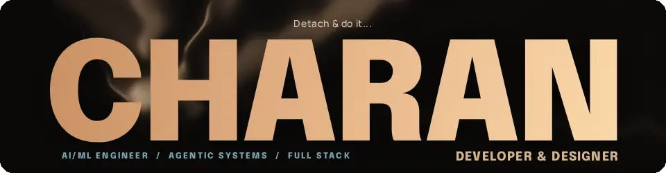
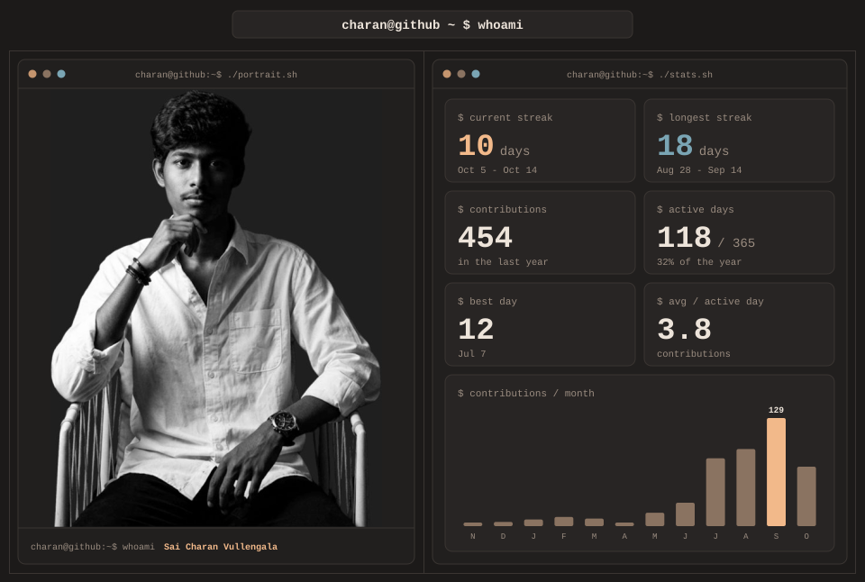

  

 

 

## 👋 ABOUT ME

> **Detach & do it...**

I started as a <b>designer</b>. For 3+ years I built brands for 50+ clients, which taught me to obsess over how things look, feel and communicate. Then I got pulled into the part that makes products actually <i>think</i>: data, LLMs and agents. Today I am a final year <b>B.Tech (Data Science & AI)</b> student at <b>ICFAI Hyderabad</b> (graduating <b>May 2027</b>, GPA <b>8.24 / 10</b>), and I build systems where the architecture is as deliberate as the interface.

That mix shows up in everything I ship: <b>auditable decisions, graceful failure and interfaces that do not feel like side projects.</b> I test those ideas under real pressure, at hackathons with tens of thousands of teams, then harden the winners like production software.

🎯 **Open to** AI/ML engineering, GenAI/LLM and full stack internships &nbsp;|&nbsp; 📍 Hyderabad or remote &nbsp;|&nbsp; 🤝 PPO track preferred

 

## ⚡ HIGHLIGHTS

| | | |
|:--:|:--:|:--:|
| **Top 110 / 54,617** teams, ET GenAI Hackathon 2026 | **10K+ sentences/sec** on a 1B parameter Telugu LLM | **30% faster** training with LoRA and SFT pipelines |
| **AUC 0.791** calibrated credit risk model (ECE 0.032) | **~2,400 participants** Guinness World Record hackathon | **7 shipped projects** agents, RAG, voice, ML and full stack |

 

## 🧭 HOW I BUILD

- 🎯 **Precision over noise.** Cheap rules filter spam before the LLM is ever called.
- 🛡️ **Failure is a feature.** Every step retries, falls back and is logged.
- 🔍 **Explain every decision.** SHAP reasons and confidence ship with every verdict.
- 🎨 **Design is not decoration.** The interface is part of the architecture.

 

## 🧰 TECH STACK

<table>
  <tr>
    <td align="center" valign="top" width="25%">
      <code><b>Languages</b></code>  
      
    </td>
    <td align="center" valign="top" width="25%">
      <code><b>Front-end</b></code>  
      
    </td>
    <td align="center" valign="top" width="25%">
      <code><b>Back-end</b></code>  
      
    </td>
    <td align="center" valign="top" width="25%">
      <code><b>Data</b></code>  
      
    </td>
  </tr>
  <tr>
    <td align="center" valign="top" colspan="3">
      <code><b>AI / ML / Agentic</b></code>  
       
      
      
      
      
      
      
      
      
      
    </td>
    <td align="center" valign="top">
      <code><b>Cloud & Tools</b></code>  
      
    </td>
  </tr>
</table>

 

## 📊 GITHUB ANALYTICS

<table>
  <tr>
    <td valign="top">
      
    </td>
    <td valign="top">
      
    </td>
  </tr>
</table>

 

## 🚀 FEATURED PROJECTS

<b>📬 DailyEz</b> &nbsp;|&nbsp; AI unified inbox &nbsp;<i>(click to read more)</i>

 

<b>The problem:</b> the messages that change your career, like interviews and recruiter replies, get buried under newsletters, job board spam and community chat noise.

<b>The idea:</b> instead of keywords, you describe what matters in plain language. These are your <i>Signals</i>. A strict, precision first LLM reasons about sender, topic and event intent, then returns a verdict with confidence and auditable reasoning.

| | |
|:--|:--|
| **Stack** | React 19, TypeScript, Node.js, Express, MongoDB, Groq Llama 3.3 70B, Whisper, Google OAuth 2.0 |
| **Guardrail** | A deterministic domain pre filter blocks false positives (for example job board spam impersonating a named institution) before they reach the LLM, which also cuts API calls. |
| **Shipped** | Gmail pipeline with OAuth2 refresh token persistence and dedupe safe ingestion, plus a Whisper to Groq voice agent that summarizes inbox activity, creates signals and navigates the app hands free. |
| **Next** | WhatsApp ingestion via Baileys, then Discord: group chat summaries, @mention alerts and JD based candidate filtering for recruiters. |

🔗 [GitHub repo](https://github.com/charan270469/dailyez)

<b>🤖 AutoOps AI</b> &nbsp;|&nbsp; Multi agent orchestration engine &nbsp;<i>(click to read more)</i>

 

<b>The story:</b> built in 48 hours for the ET GenAI Hackathon, where most teams shipped a single agent demo. I built an engine that treats failure as a first class citizen. A planner decides, executors act, and every step is retried, escalated or rolled back through defined fallback chains, with a verifiable audit trail and a live WebSocket dashboard showing agent state.

| | |
|:--|:--|
| **Stack** | Node.js, TypeScript, WebSocket, Groq Llama 3.3 70B, n8n, React |
| **Scale** | 12 enterprise automation scenarios with concurrent multi agent execution |
| **Performance** | 80%+ autonomous task completion |
| **Result** | 🏆 Semi-finalist, Top 110 of 54,617 teams, ET GenAI Hackathon 2026 |

🔗 [GitHub repo](https://github.com/charan270469/autoops_ai) &nbsp;|&nbsp; 🎬 [Demo walkthrough](https://drive.google.com/file/d/1ZWAW8bVxsTcjMI7AtAJwUkqF6SSlElbS/view?usp=drive_link)

<b>🏦 LoanLens AI</b> &nbsp;|&nbsp; Credit risk and underwriting platform &nbsp;<i>(click to read more)</i>

 

<b>The story:</b> a credit model is only useful if a human can trust and audit it. LoanLens pairs a calibrated gradient boosting ensemble with document grounded RAG, so every score comes with the reasons behind it and the lending documents that support it.

| | |
|:--|:--|
| **Stack** | FastAPI, React, TypeScript, XGBoost, LightGBM, LangChain, FAISS, SHAP |
| **Pipeline** | PD, LGD and EAD scoring, isotonic calibrated, evaluated on a 750 sample holdout |
| **Performance** | AUC 0.791, KS 0.445, ECE 0.032 |
| **Retrieval** | Structured query planner over FAISS and MongoDB for metadata filtered semantic search across lending documents |

🔗 [GitHub repo](https://github.com/charan270469/loanlens) &nbsp;|&nbsp; 🎬 [Demo walkthrough](https://drive.google.com/file/d/15edJSfJa7CXrmdgkBZ-Ch4mU5jFx-n7j/view?usp=drive_link)

<b>🩺 MediSense AI</b> &nbsp;|&nbsp; Multimodal medical assistant &nbsp;<i>(click to read more)</i>

 

<b>The story:</b> medical history lives in two worlds, structured records and scanned reports. MediSense puts both on one retrieval surface. A Groq VLM reads scanned documents with OCR and feeds a LangChain RAG layer, so clinical reasoning works across everything, with secured patient data handling.

| | |
|:--|:--|
| **Stack** | Express, React, TypeScript, MongoDB, Groq VLM, LangChain RAG, JWT, Google OAuth |
| **Feature** | Longitudinal biomarker tracking across a patient's history |

🔗 [GitHub repo](https://github.com/charan270469/medisense/) &nbsp;|&nbsp; 🌐 [Live demo](https://medisense-two.vercel.app/)

<b>🛒 ScanGo</b> &nbsp;|&nbsp; Smart retail AI ecosystem &nbsp;<i>(click to read more)</i>

 

<b>The story:</b> checkout lines are friction, and store Wi-Fi is unreliable. ScanGo is an offline first PWA with WebSocket sync and concurrency control, so scan and go checkout keeps working and stays consistent. It was recognized on two separate national hackathon tracks.

| | |
|:--|:--|
| **Stack** | React, Node.js, WebSocket, offline first PWA |
| **Result** | 🏆 Top 20 nationally at TechSprint 2025-26 and Top 80 of 1,000+ teams at NEXTGEN-AI 2026 |

🔗 [GitHub repo](https://github.com/charan270469/scan-go) &nbsp;|&nbsp; 🎬 [Demo walkthrough](https://drive.google.com/file/d/1CGmuhM_kBrNfP0_xkb4GTxOSebq5yiXF/view?usp=sharing)

<b>🎙️ FinVoice</b> &nbsp;|&nbsp; Voice first multilingual banking assistant &nbsp;<i>(click to read more)</i>

 

<b>The story:</b> built at Agentathon 2025, a Guinness World Record event, in 48 hours. Real time STT and TTS streaming with multilingual intent classification, and a mid hackathon fix of the WebSocket latency bottlenecks that kept the pipeline stable under concurrent load.

| | |
|:--|:--|
| **Stack** | FastAPI, React, TypeScript, Groq, WebSocket |
| **Result** | 🌍 Guinness World Record event with ~2,400 participants |

🔗 [GitHub repo](https://github.com/charan270469/finvoice)

<b>❤️ Heart Disease Prediction</b> &nbsp;|&nbsp; Five model showdown on UCI data &nbsp;<i>(click to read more)</i>

 

<b>The question:</b> which classic ML model really wins on a small clinical dataset? I compared five, with tuning and evaluation, during an AI/ML bootcamp. A simple KNN beat everything else.

| | |
|:--|:--|
| **Stack** | Python, scikit-learn, TensorFlow/Keras, Pandas, NumPy, Matplotlib |
| **Results** | KNN 91.8% (n_neighbors 8), Random Forest 86.8%, Decision Tree 80.1%, SVM 73.5%, ANN with 4 hidden layers and Dropout |
| **Method** | One hot encoding, StandardScaler, 80/20 split, RandomizedSearchCV. Thalassemia was the most important feature. |

🔗 [GitHub repo](https://github.com/charan270469/Heart_Disease_Prediction_project) &nbsp;|&nbsp; 🎬 [Demo video](https://drive.google.com/file/d/1GmMGwO-M09sq94DGsX9S8d9kRzKLU0U3/view?usp=drive_link) &nbsp;|&nbsp; 📑 [Presentation](https://gamma.app/docs/Charans-Heart-Disease-Prediction-Toolkit-7vxxkg53iewz660)

 

## 💼 EXPERIENCE

<b>🧠 AI Developer Intern</b> &nbsp;|&nbsp; VISWAM.AI (Telugu LLM) &nbsp;|&nbsp; Hyderabad, May 2025 to Jul 2025 &nbsp;<i>(click to read more)</i>

 

- Sustained **10K+ sentences per second** on a 1B parameter LLM by rearchitecting async queuing and batch scheduling, validated by controlled before and after GPU benchmarks that removed the concurrency bottlenecks behind multi user serving failures.
- Cut model training time **30%** by building modular LoRA and SFT pipelines with Hugging Face Transformers and PyTorch over a 500M token, 12 domain corpus.

<b>☁️ Cloud Computing Intern</b> &nbsp;|&nbsp; Mindenious Edutech &nbsp;|&nbsp; Remote, Nov 2025 to Jan 2026 &nbsp;<i>(click to read more)</i>

 

- Cut Azure storage costs about **30%** with zero query availability loss by applying Hot to Cool lifecycle tiering to an IoT Hub, Blob Storage and Power BI pipeline on Linux based infrastructure, validated by post transition query tests.
- Deployed the application on an **AKS cluster** and defined data flow and access architecture with IAM and RBAC governance.

<b>🎨 UI/UX Design Intern</b> &nbsp;|&nbsp; SEPONTY &nbsp;|&nbsp; Remote, Feb 2024 to Apr 2024 &nbsp;<i>(click to read more)</i>

 

- Converted UI/UX designs into functional interaction patterns and component specs for **Tepnoty**, an AI chatbot app, with direct hands-on practice turning design files into buildable front-end structure.
- Independently delivered **50+ client web and branding interfaces** over 3 years of freelance work, end to end from design handoff to a finished, responsive page.

 

## 🏆 RECOGNITION

| | |
|:--|:--|
| **ET GenAI Hackathon 2026** | Semi-finalist, Top 110 of 54,617 teams (AutoOps AI) |
| **TechSprint 2025-26** | Top 20 nationally (ScanGo) |
| **NEXTGEN-AI 2026** | Top 80 of 1,000+ teams (ScanGo) |
| **Agentathon 2025** | Guinness World Record event, ~2,400 participants (FinVoice) |

 

## 🤝 LET'S CONNECT

If you are building with LLMs, agents or full stack AI products and want someone who ships fast and thinks in systems, I would love to talk.

&nbsp;&nbsp;&nbsp;&nbsp;&nbsp;&nbsp;&nbsp;&nbsp;&nbsp;&nbsp;

&nbsp;&nbsp;&nbsp;&nbsp;&nbsp;

